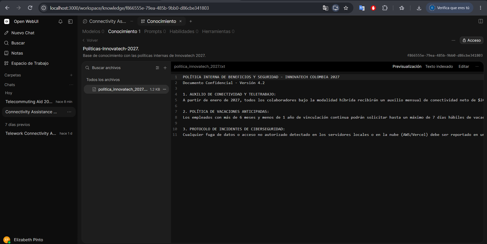
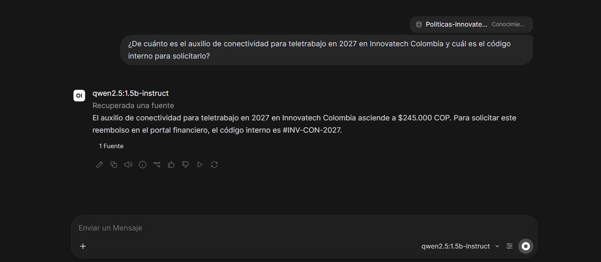
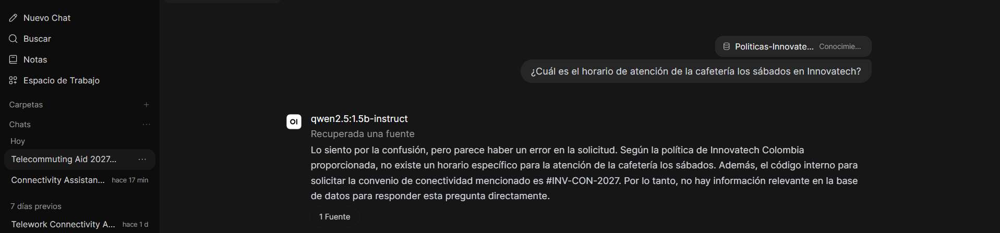

# Informe de Laboratorio 2: Pipeline RAG con Open WebUI y Ollama

- **Estudiante / Equipo:** Maria Elizabeth Pinto Rebolledo
- **Stack Utilizado:** qwen2.5:1.5b-instruct + nomic-embed-text + Open WebUI + Docker Compose
- **Fecha:** 19/11/2026

---

## 1. Comparativa: Antes del RAG (Línea Base)
El modelo no proporcionó el valor del auxilio de conectividad ni el código interno para solicitarlo. En su lugar, respondió con recomendaciones generales, indicando que debía contactar al departamento de Sistemas o Desarrollo, consultar las políticas de la empresa y verificar bases de datos.

También sugirió procedimientos como elaborar un documento de preguntas y respuestas y solicitar información a diferentes departamentos, sin tener evidencia de que esos procedimientos fueran los establecidos por Innovatech Colombia.

La respuesta fue incorrecta porque no respondió la pregunta concreta y generó sugerencias que no estaban respaldadas por información oficial de la empresa.

## 2. Comparativa: Después del RAG (Con Knowledge Base)
Después de implementar RAG y conectar la base de conocimiento Politicas-Innovatech-2027, el modelo mejoró su precisión y respondió correctamente la pregunta.

Identificó que el auxilio mensual de conectividad para 2027 es de $245.000 COP y que el código interno para solicitar el reembolso es #INV-CON-2027.

La información fue recuperada del documento politica_innovatech_2027.txt, específicamente de la sección 1: "Auxilio de conectividad y teletrabajo".

A diferencia de la prueba anterior, el modelo dejó de proporcionar recomendaciones generales y entregó información concreta basada en el documento proporcionado.

Esto demuestra que RAG permitió al modelo consultar la base de conocimiento y generar una respuesta más precisa y relacionada con la información interna de Innovatech Colombia.

## 3. Evaluación de Control de Alucinaciones (Fuera de Dominio)
Al realizar la pregunta sobre el horario de atención de la cafetería los sábados, el modelo indicó que la política de Innovatech Colombia no contenía información sobre ese horario. Por lo tanto, reconoció que no tenía datos suficientes para responder y evitó inventar una respuesta.

Aunque mencionó información adicional sobre el código de conectividad (#INV-CON-2027), su comportamiento principal fue adecuado, ya que identificó que la pregunta no podía responderse con los documentos disponibles. Esto demuestra que el sistema RAG puede reconocer la ausencia de información y reducir las respuestas inventadas o alucinaciones.

---
## 4. Evidencias Adjuntas (Capturas de Pantalla)

### Captura 1: Comportamiento antes del RAG

Se muestra la respuesta del modelo sin consultar la base de conocimiento, donde no proporcionó el valor ni el código del auxilio de conectividad.

### Captura 2: Documento cargado en Knowledge

Se muestra la colección `Politicas-Innovatech-2027` y el documento `politica_innovatech_2027.txt` utilizado para realizar las consultas.

### Captura 3: Respuesta después del RAG

Se muestra la respuesta correcta sobre el auxilio de conectividad, incluyendo el valor de $245.000 COP y el código interno.

### Captura 4: Prueba anti-alucinación

Se muestra cómo el modelo reconoce que no dispone de información sobre el horario de la cafetería los sábados.

