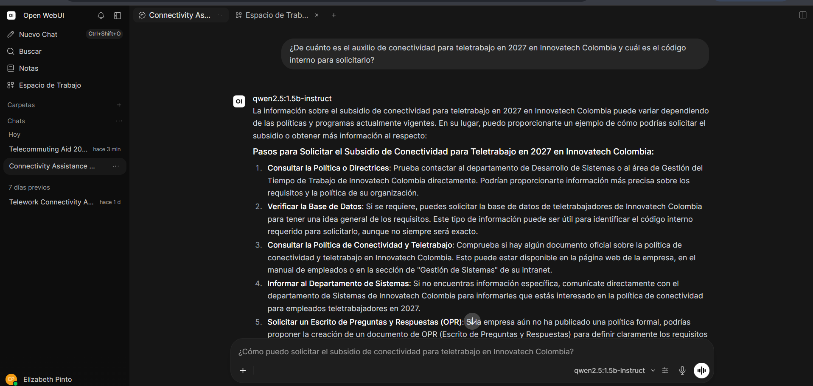
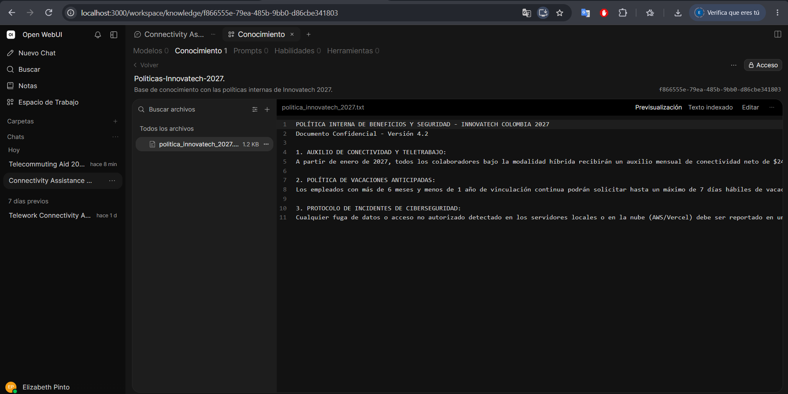
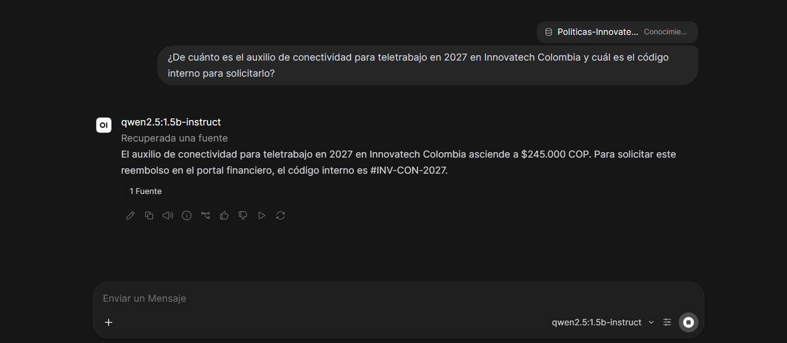
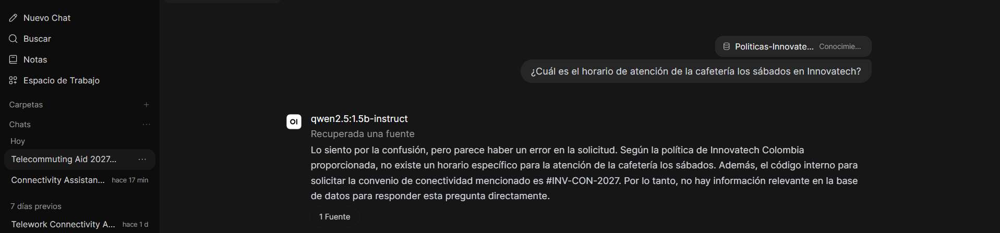
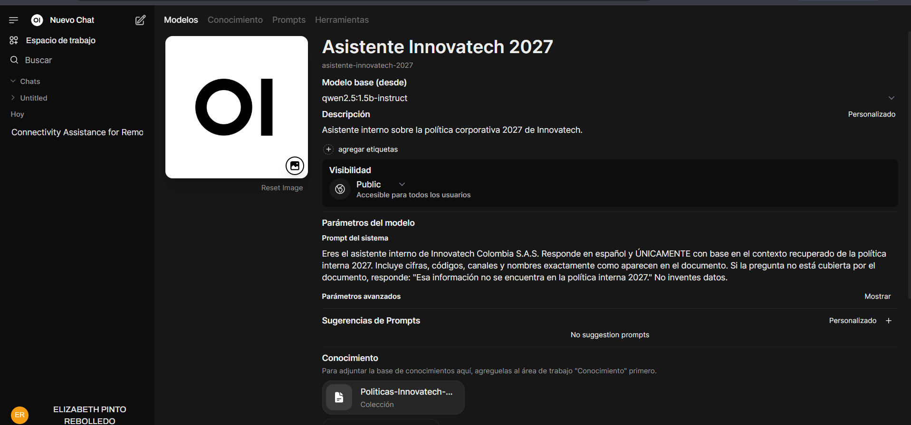
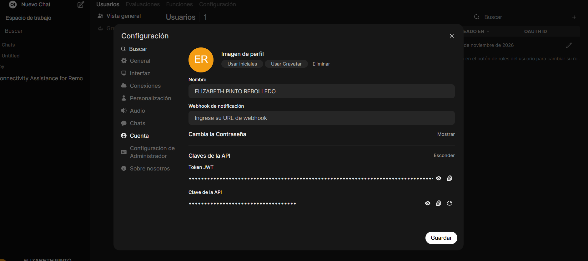
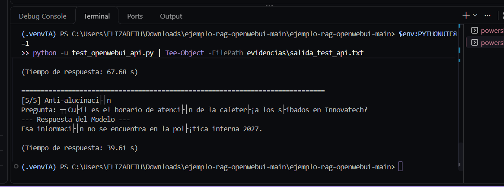

# Lab 2: Pipeline RAG Documental con Open WebUI y Ollama + Modelo Personalizado por API

**Estudiante:** Maria Elizabeth Pinto Rebolledo
**Curso:** LLMOps, Serving Local y Arquitecturas RAG
**Repositorio base del docente:** https://github.com/FerchoRV/ejemplo-rag-openwebui

Este repositorio reúne las dos partes de la práctica:

1. **Lab 2:** RAG 100 % local con Ollama + Open WebUI y comparación *Antes vs. Después del RAG* sobre la política interna de Innovatech Colombia 2027.
2. **Actividad final:** modelo personalizado en Open WebUI con la base de conocimiento del Lab 2, consumido por API desde Python (`test_openwebui_api.py`).

## Stack

| Componente | Detalle |
|---|---|
| Inferencia | Ollama (`ollama-rag-lab`, puerto 11434) |
| Interfaz y RAG | Open WebUI v0.5.20 (`open-webui-lab`, puerto 3000) |
| Modelo base | `qwen2.5:1.5b-instruct` |
| Embeddings | `nomic-embed-text` |
| Base de conocimiento | `Politicas-Innovatech-2027` (archivo `politica_innovatech_2027.txt`) |
| Modelo personalizado | `asistente-innovatech-2027` |
| Cliente API | `test_openwebui_api.py` (librería `openai` apuntando a `http://localhost:3000/api`) |

## Estructura

```
.
├── README.md
├── docker-compose.yml                  # Ollama + Open WebUI
├── requirements.txt                    # openai, python-dotenv
├── .env.example                        # Plantilla (el .env con la API key NO se sube)
├── test_openwebui_api.py               # Consumo del modelo personalizado por API
├── politica_innovatech_2027.txt        # Documento del caso de estudio
├── Entregable_Lab2_RAG_Maria_Elizabeth_Pinto_Rebolledo.md   # Informe del Lab 2
└── evidencias/
    ├── prueba-antes-rag.png            # Lab 2
    ├── documento-rag.png               # Lab 2
    ├── prueba-despues-rag.png          # Lab 2
    ├── prueba-anti-alucinacion.png     # Lab 2
    ├── modelo_personalizado.png        # Actividad final
    ├── api_key.png                     # Actividad final
    ├── terminal_test_api.png           # Actividad final
    └── salida_test_api.txt             # Salida completa del script
```

---

## Parte 1: Lab 2 (Antes vs. Después del RAG)

El informe completo está en [Entregable_Lab2_RAG_Maria_Elizabeth_Pinto_Rebolledo.md](Entregable_Lab2_RAG_Maria_Elizabeth_Pinto_Rebolledo.md).

| Prueba | Resultado |
|---|---|
| Sin RAG | El modelo no dio el valor ni el código; respondió con recomendaciones genéricas no respaldadas por la empresa. |
| Con `#Politicas-Innovatech-2027` | Respondió **$245.000 COP** y el código **#INV-CON-2027**, citando el documento. |
| Anti-alucinación (cafetería) | Reconoció que la política no contiene esa información y no inventó un horario. |

**Antes del RAG**


**Documento indexado en Knowledge**


**Después del RAG**


**Prueba anti-alucinación**


---

## Parte 2: Modelo personalizado consumido por API

### 1. Creación del modelo personalizado
En *Espacio de trabajo → Modelos* se creó **Asistente Innovatech 2027** (ID `asistente-innovatech-2027`):
- Modelo base: `qwen2.5:1.5b-instruct`
- Visibilidad: **Public**
- Prompt del sistema que restringe las respuestas al contenido de la política interna 2027
- Conocimiento vinculado: colección `Politicas-Innovatech-2027`



### 2. API Key
Generada en *Configuración → Cuenta → Claves de la API* (la clave permanece oculta en la captura).



### 3. Consumo por API con `test_openwebui_api.py`
El script lee `OPENWEBUI_API_KEY` y `TARGET_MODEL` desde `.env`, verifica que el modelo exista y le envía, **sin usar `#`**, la batería de preguntas del Lab 2: presentación, dato exacto, condicional, protocolo técnico y anti-alucinación. Open WebUI ejecuta la búsqueda vectorial automáticamente porque la Knowledge está vinculada al modelo.



La salida completa de la ejecución está en [evidencias/salida_test_api.txt](evidencias/salida_test_api.txt). Resultados:

| # | Prueba | Respuesta del modelo (resumen) | Tiempo | ¿Correcta? |
|---|---|---|---|---|
| 1 | Presentación | Se presenta como asistente interno de Innovatech Colombia S.A.S. para consultas sobre la política interna 2027 | 72.99 s | ✅ |
| 2 | Dato exacto | **$245.000 COP** y código **#INV-CON-2027** | 20.11 s | ✅ |
| 3 | Condicional / Rol | Hasta **7 días hábiles**, con aprobación del líder de proyecto y RR. HH. (directora **Laura Martínez**) | 23.00 s | ✅ |
| 4 | Protocolo técnico | Reporte en **menos de 2 horas** a **#sec-incidentes-urgente** o ext. **809**; cifrado **AES-256** con rotación trimestral | 67.68 s | ✅ |
| 5 | Anti-alucinación | *"Esa información no se encuentra en la política interna 2027."* | 39.61 s | ✅ |

El modelo personalizado respondió correctamente las 5 consultas por API sin necesidad de usar `#`. En la pregunta fuera de dominio aplicó literalmente la regla del prompt del sistema en lugar de inventar un horario. La primera respuesta tardó más porque incluyó la carga inicial del modelo en memoria.

> Nota: en la captura las tildes se ven alteradas por la codificación de la consola de PowerShell; el archivo `salida_test_api.txt` contiene el texto corregido.

---

## Cómo reproducir

```bash
docker compose up -d
docker exec -it ollama-rag-lab ollama pull qwen2.5:1.5b-instruct
docker exec -it ollama-rag-lab ollama pull nomic-embed-text

python -m venv .venvIA
# Windows: .venvIA\Scripts\Activate.ps1   |   Linux/Mac: source .venvIA/bin/activate
pip install -r requirements.txt

# Copiar .env.example como .env y poner la API key de Open WebUI
python -u test_openwebui_api.py
```

## Conclusiones

- Sin RAG, el modelo pequeño no conoce información privada de la empresa y tiende a responder con generalidades. Con la base de conocimiento, entrega los datos exactos del documento y cita la fuente.
- La prueba fuera de dominio muestra que el RAG ayuda a reducir alucinaciones: el modelo reconoce cuándo el documento no tiene la respuesta.
- Al vincular la Knowledge a un modelo personalizado ya no hace falta seleccionar la colección con `#`. El RAG se aplica automáticamente, también en las llamadas por API: el modelo `asistente-innovatech-2027` acertó las 5 pruebas ejecutadas desde Python.
- Open WebUI expone una API compatible con OpenAI, así que el modelo personalizado se consume con el cliente oficial `openai` cambiando solo la `base_url`, la API key y el ID del modelo.
